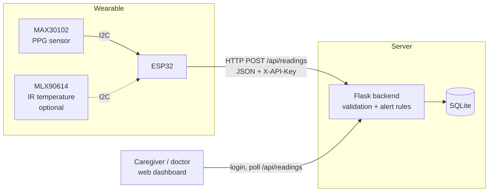
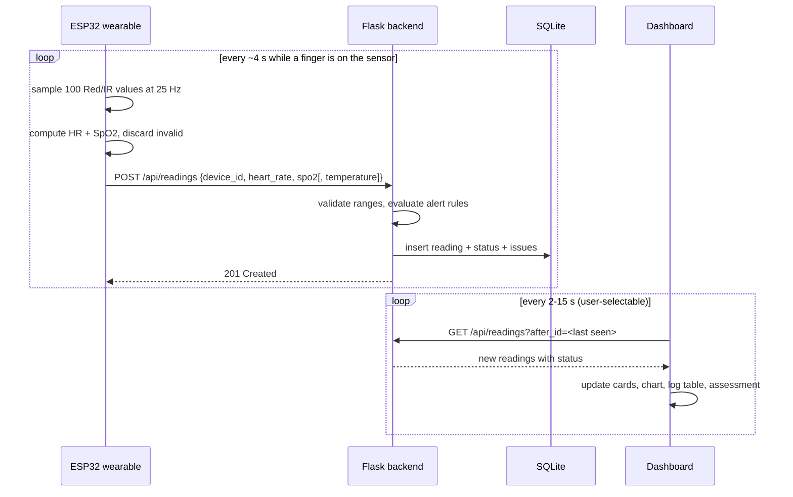

# Vital Touch: Technical Design Document

## 1. Purpose

Vital Touch is a low-cost wearable that continuously measures heart rate and
blood-oxygen saturation (SpO2) and makes the readings, plus automatic alerts,
available to a caregiver or doctor on a web dashboard. It targets people who
are not in hospital but need watching: elderly people living alone,
post-operative and chronic patients, and rural households far from
specialist care.

It is a **monitoring aid, not a diagnostic device**.

## 2. Architecture



| Layer | Technology | Location |
|---|---|---|
| Sensing | MAX30102 (Red + IR PPG); optional MLX90614 | wearable |
| Firmware | ESP32, Arduino C++, SparkFun MAX3010x library, Maxim SpO2 algorithm | `firmware/` |
| Transport | WiFi, HTTP + JSON, shared device API key | |
| Backend | Python 3, Flask, SQLite | `backend/` |
| Alert rules | Pure Python module, unit-tested | `backend/alerts.py` |
| Dashboard | HTML, Tailwind CSS, Chart.js, vanilla JS | `frontend/index.html` |

## 3. Data flow



If WiFi drops, the firmware keeps up to 20 unsent readings in a ring buffer and
sends them, oldest first, once the connection returns.

## 4. Firmware

1. Configure the MAX30102 for 100 samples/s with 4-sample averaging, giving
   **25 effective samples/s**. The Maxim algorithm assumes exactly this rate;
   other rates make the heart-rate output unreliable.
2. Collect a 100-sample window (4 s).
3. If the IR level is below 50,000 there is no finger on the sensor; skip.
4. Run `maxim_heart_rate_and_oxygen_saturation`. Discard the window unless both
   values are flagged valid and plausible (HR 30-220 bpm, SpO2 70-100%).
5. Optionally read the MLX90614 object temperature.
6. Queue the reading and flush the queue to the backend.

## 5. Backend API

| Method | Path | Auth | Purpose |
|---|---|---|---|
| POST | `/api/readings` | `X-API-Key` header | Device uploads a reading |
| POST | `/api/login` | username + password | Start dashboard session |
| POST | `/api/logout` | session | End session |
| GET | `/api/me` | session | Current user |
| GET | `/api/readings?after_id=&limit=` | session | Readings newer than `after_id` (polling) |
| GET | `/api/readings/latest` | session | Most recent reading |
| POST | `/api/sos` | session | Record an SOS event |
| GET | `/api/events` | session | Recent SOS events |
| GET | `/api/health` | none | Liveness check |
| GET | `/` | none | Dashboard page |

Example device request:

```http
POST /api/readings
Content-Type: application/json
X-API-Key: <device key>

{"device_id": "ESP32_01", "heart_rate": 76, "spo2": 98}
```

Example response (`201`):

```json
{"id": 42, "device_id": "ESP32_01", "heart_rate": 76, "spo2": 98,
 "temperature": null, "status": "normal", "issues": [],
 "source": "device", "created_at": "2026-10-26T10:15:02+00:00"}
```

## 6. Data model

**readings**

| Column | Type | Notes |
|---|---|---|
| id | INTEGER PK | autoincrement, used as polling cursor |
| device_id | TEXT | e.g. `ESP32_01` |
| heart_rate | INTEGER | bpm |
| spo2 | INTEGER | % |
| temperature | REAL NULL | °C, null when no temperature sensor |
| status | TEXT | `normal` / `warning` / `critical` |
| issues | TEXT | JSON list of detected issues |
| source | TEXT | `device` or `simulator` |
| created_at | TEXT | ISO-8601 UTC |

**events**: id, type (`sos`), message, created_by, created_at.

## 7. Alert rules (`backend/alerts.py`)

| Condition | Status |
|---|---|
| HR > 100 bpm | warning (tachycardia) |
| HR < 60 bpm | warning (bradycardia) |
| SpO2 < 95% | warning |
| SpO2 < 90% | critical |
| Temperature > 37.5 °C | warning (fever) |
| Temperature < 35.0 °C | critical (hypothermia risk) |

The overall status is the most severe triggered level; a later warning never
downgrades an earlier critical. These are adult screening defaults and are
kept in one module so they can be tuned per patient in future.

Readings outside physically plausible ranges (HR 20-250, SpO2 50-100,
temperature 25-45 °C) are rejected with `400` as sensor errors.

## 8. Security

- The device authenticates with a shared API key; the dashboard uses a
  server-side session. Both secrets come from environment variables
  (`backend/.env`), never from source code.
- Login and ingest endpoints refuse to work (`503`) until secrets are set.
- Secrets are compared in constant time; session cookies are HttpOnly.
- WiFi credentials live in the git-ignored `firmware/.../config.h`.

## 9. Demo mode

With `VT_SIMULATE=1` the backend generates synthetic readings, stored with
`source = "simulator"`. The dashboard labels these **"Simulated data (demo
mode)"** so they are never mistaken for patient data. Alternatively,
`tools/replay_sample_data.py` sends the fixed sample set through the real
device endpoint.

## 10. Testing

`pytest` covers the alert rules (all thresholds, boundaries, severity
ordering), input validation, authentication, polling and SOS logging. See
`tests/`. Sample payloads are in `sample_data/`.

## 11. Known limitations and roadmap

| Limitation | Plan |
|---|---|
| PPG readings are sensitive to hand movement | Use the motion sensor (MPU6050) to reject readings during movement; add fall detection |
| Needs WiFi | Offline buffer already in firmware; add GSM/BLE gateway for homes without WiFi |
| Single admin account | Per-caregiver accounts and roles |
| Alerts visible only on the dashboard | Push/SMS notifications to caregivers |
| Fixed thresholds | Per-patient thresholds; trend-based anomaly detection |
| Not clinically validated | Accuracy study against a reference pulse oximeter before any clinical use |
