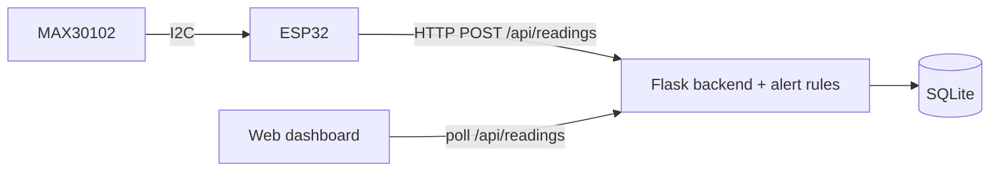

# Vital Touch

**Low-cost IoT wearable for remote health monitoring of elderly and rural patients.**

Vital Touch measures heart rate and blood-oxygen saturation (SpO2) on an
ESP32 wearable, sends each reading over WiFi to a small server, flags abnormal
values automatically, and shows everything on a web dashboard that a caregiver
or doctor can open from any browser.

> Vital Touch is a monitoring aid, not a medical device, and does not provide a diagnosis.

Submitted to **Hack for Social Cause (VBYLD 2027)**, theme: Healthcare / Elderly Care.

---

## Features

- Heart rate and SpO2 from a MAX30102 sensor, using the Maxim reference algorithm at the sample rate it expects
- Optional body temperature from an MLX90614 IR sensor
- WiFi upload with an offline queue: readings taken during a WiFi drop are sent when it returns
- Server-side validation and alert rules (normal / warning / critical), covered by unit tests
- Dashboard: live vitals, HR/SpO2 history chart, status breakdown, automated assessment with suggested next steps, full reading log with CSV export, SOS event logging
- Login-protected dashboard; device authenticated by API key; all secrets in environment variables
- Demo mode with clearly labelled simulated data when no hardware is connected

## Architecture



Full details (data flow, API, schema, thresholds, security, roadmap) are in
[`docs/DESIGN.md`](docs/DESIGN.md).

## Repository structure

```
vital-touch/
├── firmware/vital_touch_esp32/   ESP32 sketch + config template
├── backend/                      Flask API, alert rules, SQLite storage
├── frontend/index.html           Monitoring dashboard (served by the backend)
├── docs/DESIGN.md                Technical design document
├── sample_data/                  Sample device payloads covering every alert case
├── tests/                        pytest suite
├── tools/replay_sample_data.py   Sends sample data to the backend (no hardware needed)
├── requirements-dev.txt
└── LICENSE                       MIT
```

## Hardware

| Component | Purpose |
|---|---|
| ESP32 Dev board | Microcontroller + WiFi |
| MAX30102 module | Heart rate + SpO2 (PPG) |
| MLX90614 module (optional) | Contactless body temperature |

Wiring (both sensors share the I2C bus):

| Sensor pin | ESP32 pin |
|---|---|
| VIN | 3V3 |
| GND | GND |
| SDA | GPIO 21 |
| SCL | GPIO 22 |

## Setup

### 1. Backend and dashboard

Requires Python 3.10+.

```bash
cd backend
pip install -r requirements.txt
cp .env.example .env          # Windows: copy .env.example .env
# edit .env: set VT_ADMIN_PASSWORD, VT_DEVICE_API_KEY and VT_SECRET_KEY
python app.py
```

Open <http://localhost:5000> and log in with `VT_ADMIN_USERNAME` / `VT_ADMIN_PASSWORD`.

#### Environment variables (`backend/.env`)

| Variable | Required | Default | Description |
|---|---|---|---|
| `VT_ADMIN_PASSWORD` | yes | (none) | Dashboard password; login is disabled until set |
| `VT_DEVICE_API_KEY` | yes | (none) | Key the ESP32 sends in `X-API-Key`; ingest is disabled until set |
| `VT_SECRET_KEY` | recommended | random per start | Signs login sessions |
| `VT_ADMIN_USERNAME` | no | `admin` | Dashboard username |
| `VT_ADMIN_NAME` | no | `Administrator` | Name shown in the dashboard |
| `VT_DATABASE` | no | `backend/vital_touch.db` | SQLite file path |
| `VT_HOST` / `VT_PORT` | no | `0.0.0.0` / `5000` | Listen address |
| `VT_SIMULATE` | no | `0` | `1` = generate labelled simulated readings (demo without hardware) |

### 2. Firmware

1. Install the Arduino IDE and the **esp32** board package (Espressif).
2. Library Manager: install **SparkFun MAX3010x Pulse and Proximity Sensor Library**
   (and **Adafruit MLX90614 Library** if you fit the temperature sensor).
3. In `firmware/vital_touch_esp32/`, copy `config.example.h` to `config.h` and set
   your WiFi name/password, the backend address (`http://<laptop-ip>:5000`),
   and the same device key as `VT_DEVICE_API_KEY`.
4. Select **ESP32 Dev Module**, upload, and open Serial Monitor at 115200 baud.
5. Place a finger on the sensor. Readings appear on Serial and on the dashboard
   with the badge **"Live device: ESP32_01"**.

The ESP32 and the computer running the backend must be on the same network.

### 3. Try it without hardware

```bash
# terminal 1
cd backend && python app.py
# terminal 2
python tools/replay_sample_data.py --url http://localhost:5000 --key <VT_DEVICE_API_KEY>
```

Or set `VT_SIMULATE=1` in `.env` for a continuous simulated stream (labelled
"Simulated data (demo mode)" on the dashboard).

## Tests

```bash
pip install -r requirements-dev.txt
pytest
```

The suite covers every alert threshold and boundary, severity ordering,
input validation, device authentication, login, polling and SOS logging.

## Sample data

[`sample_data/sample_readings.json`](sample_data/sample_readings.json) contains
20 device payloads covering normal, warning and critical cases. See
[`sample_data/README.md`](sample_data/README.md).

## Roadmap

Motion-artifact rejection and fall detection (MPU6050), push/SMS alerts to
caregivers, GSM/BLE gateway for homes without WiFi, per-patient thresholds,
and an accuracy study against a reference pulse oximeter.

## Team

Sri Sairam Engineering College, Chennai, Tamil Nadu.

- Divyesh Kumar N (Team Lead)
- Sarvesh Datta V
- _third member_

## License

[MIT](LICENSE)
